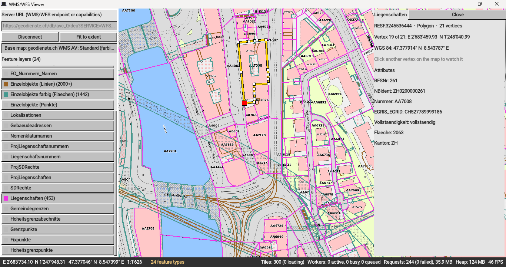

# WMS/WFS Viewer

A Web Map Service and Web Feature Service demo app made with [Umka](https://github.com/vtereshkov/umka-lang) and [Tophat](https://tophat2d.dev).

You can [download](https://github.com/vtereshkov/wms-wfs-viewer/releases) the release and launch `run.bat` or `run.sh`.

Alternatively, to run the demo directly from the repository folder, install [UmBox](https://umbox.tophat2d.dev/) and run
```
umbox update -c
umbox run
```

The demo shows a base map from a WMS and feature layers from a WFS. The servers to choose from are listed in `servers.xml`: the cadastral surveys of Switzerland, Lower Saxony, North Rhine-Westphalia, Norway and the Netherlands. More servers can be added there.


