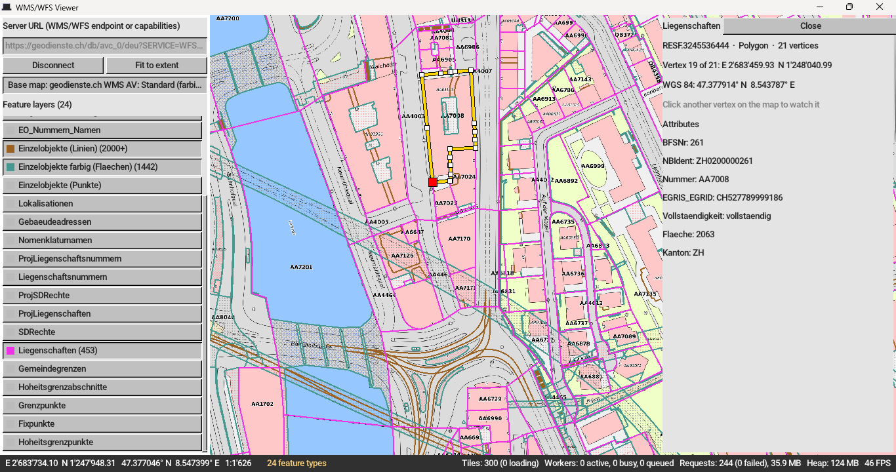

# WMS/WFS Viewer

A Web Map Service and Web Feature Service demo app made with [Umka](https://github.com/vtereshkov/umka-lang) and [Tophat](https://tophat2d.dev).

You can [download](https://github.com/vtereshkov/wms-wfs-viewer/releases) the release.

Alternatively, to run the demo directly from the repository folder, install [UmBox](https://umbox.tophat2d.dev/) and run
```
umbox update -c
umbox run
```

The demo requires a server that provides both WMS and WFS data. 


